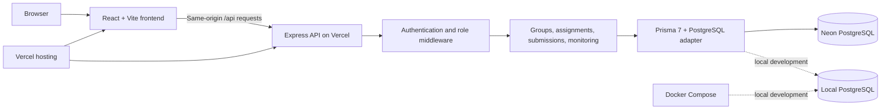

# Joineazy

**A role-based student, group, and assignment management platform.** Joineazy helps students form groups, access professor-assigned work, and individually confirm submissions. Professors can distribute assignments and monitor group-wise progress and student confirmations from one dashboard.

> **Submission files remain in OneDrive.** Joineazy stores assignment details and submission-confirmation metadata; it does not upload, store, or inspect the assignment files themselves.

## Live application and demo

| Resource | Link |
| --- | --- |
| **Live application** | [joineazy-task01.vercel.app](https://joineazy-task01.vercel.app/) |
| **Demo walkthrough** | [Watch the Joineazy demo on Loom](https://www.loom.com/share/c5164d9a91594793b8ef39a511647a89) |
| **GitHub repository** | [Shivraj098/JoinEazy-Task01](https://github.com/Shivraj098/JoinEazy-Task01) |

## Features

### Student workspace

- Register with a name, email, official student ID, and password; sign in and sign out.
- Create one group and become its leader.
- Search for registered students by name, email, or student ID and add eligible members. Only the group leader can add members.
- View assignments shared with all students or assigned specifically to the student's group.
- Open the professor-provided HTTPS OneDrive submission link.
- Confirm a submission individually through a two-step confirmation flow.
- Track group progress, each member's confirmation status, and recorded timestamps.

### Professor workspace

- Sign in through a provisioned professor (admin) account.
- Create, view, and edit assignments with a title, description, due date, and OneDrive link.
- Assign work to all students or selected groups.
- View workspace counts for students, students without a group, groups, assignments, completed group-assignment pairs, and overdue pairs.
- Monitor each eligible group's progress and inspect individual student confirmations and timestamps.
- Filter monitoring by assignment and group-assignment status.
- Review submission-status breakdowns and the overall completion metric.

## Technology stack

| Layer | Technology |
| --- | --- |
| Frontend | React 19, TypeScript 5.9, Vite 7 |
| Routing | React Router 7 |
| Styling | Tailwind CSS 4 |
| Backend | Node.js 22, Express 5, TypeScript 5.9 (ESM / NodeNext) |
| API validation | Zod 4 |
| Database access | Prisma 7 with the PostgreSQL `pg` adapter |
| Database | PostgreSQL (local Docker or Neon) |
| Authentication | JWT with `jose`, HttpOnly session cookie, `bcryptjs` password hashing |
| Testing | Vitest and Supertest |
| Code quality | ESLint 9 and Prettier 3 |
| Local infrastructure | Docker and Docker Compose |
| Production hosting | Vercel and Neon PostgreSQL |

Exact dependency versions are pinned in the workspace `package.json` files and `package-lock.json`.

## Architecture

Joineazy is an npm-workspaces monorepo with separate `frontend/` and `backend/` applications. During local development, Vite proxies `/api` requests to the Express server. In production, Vercel serves the built React application and routes `/api/*` requests to the Express application exposed through `api/index.ts`. The browser and API share one origin, allowing the HttpOnly session cookie to remain first-party.



For component boundaries, request lifecycle, security controls, and deployment details, see [System Design](docs/SYSTEM_DESIGN.md). For the relational model, relationships, and database constraints, see [Database Design](docs/DATABASE_DESIGN.md).

## Repository structure

```text
.
├── api/
│   └── index.ts                 # Vercel Express function entry point
├── backend/
│   ├── prisma/
│   │   ├── migrations/          # Committed Prisma migration history
│   │   ├── schema.prisma        # Relational data model
│   │   └── seed.ts              # Idempotent professor-account seed
│   ├── src/
│   │   ├── config/              # Validated environment configuration
│   │   ├── lib/                 # Prisma, password, and session helpers
│   │   ├── middleware/          # Authentication, authorization, and errors
│   │   ├── modules/             # Auth, groups, assignments, submissions, monitoring
│   │   ├── types/               # Shared Express request types
│   │   └── utils/               # Validation, normalization, and application errors
│   └── tests/                   # Backend unit and API tests
├── docs/
│   ├── SYSTEM_DESIGN.md
│   └── DATABASE_DESIGN.md
├── frontend/
│   └── src/
│       ├── components/          # Shared layout and form components
│       ├── features/            # Auth, groups, assignments, and dashboards
│       └── lib/                 # Typed API client
├── Dockerfile.backend
├── Dockerfile.frontend
├── docker-compose.yml
├── package.json                # npm workspace scripts
└── vercel.json                 # Vercel build and same-origin routing
```

## Getting started

### Prerequisites

- Node.js 22.x and npm.
- Docker Desktop for the local PostgreSQL workflow, or a PostgreSQL-compatible database.
- Git.

### 1. Clone and install

Run from the repository root:

```powershell
git clone https://github.com/Shivraj098/JoinEazy-Task01.git
cd JoinEazy-Task01
npm install
```

The root `postinstall` script generates the Prisma client. The generated client is not committed to Git.

### 2. Configure environment variables

Copy `.env.example` to `.env` in the repository root:

```powershell
Copy-Item .env.example .env
```

Set a strong `JWT_SECRET` of at least 32 characters and configure the professor account values before running the seed command. Keep `.env` out of version control. Never commit database credentials, JWT secrets, or account passwords.

### 3. Start PostgreSQL and apply migrations

The local Docker Compose database publishes PostgreSQL on host port `5433` to avoid conflicts with a local service already using `5432`.

```powershell
npm run db:up
npm run db:deploy
```

`db:deploy` applies the committed migration history to the configured database. For local development, `DATABASE_URL` should point to the local Compose database. For a hosted Neon database, use the pooled connection string for runtime and the direct connection string for Prisma migration and seed operations.

When the Prisma schema changes during development, create a new migration and commit it with the schema change:

```powershell
npm run db:migrate --workspace=backend -- --name descriptive_migration_name
```

Use `npm run db:deploy` to apply committed migrations in deployment environments; do not use `prisma migrate dev` as a production deployment command.

### 4. Seed the professor account

Set `ADMIN_NAME`, `ADMIN_EMAIL`, and `ADMIN_PASSWORD` in the root `.env`, then run:

```powershell
npm run db:seed
```

The seed is idempotent. It creates the configured admin account if it does not exist and updates that account's name, password hash, and role if it already exists. The public registration flow creates student accounts only; professor accounts are provisioned through this seed process.

### 5. Run the applications

Open two terminals from the repository root.

**Terminal 1 — backend:**

```powershell
npm run dev:backend
```

**Terminal 2 — frontend:**

```powershell
npm run dev:frontend
```

Vite serves the frontend at `http://localhost:5173` and proxies `/api` requests to the Express development server on port `4000`. For the normal cookie-based browser flow, open the Vite frontend rather than calling the backend port directly.

## Environment variables

| Variable | Required | Purpose |
| --- | --- | --- |
| `NODE_ENV` | No | `development`, `test`, or `production`; defaults to `development`. |
| `PORT` | No | Local Express port; defaults to `4000`. |
| `DATABASE_URL` | Yes | PostgreSQL connection used by the application at runtime. |
| `DIRECT_URL` | No | Direct PostgreSQL connection for migration and seed operations; useful with Neon. |
| `JWT_SECRET` | Yes | Signing secret of at least 32 characters; never use the example placeholder. |
| `JWT_EXPIRES_IN_HOURS` | No | Session lifetime in hours; defaults to `24`, maximum `168`. |
| `AUTH_COOKIE_NAME` | No | Session cookie name; defaults to `joineazy_session`. |
| `APP_ORIGIN` | No | Allowed local frontend origin for state-changing requests; defaults to `http://localhost:5173`. |
| `BCRYPT_ROUNDS` | No | Password hashing work factor; defaults to `12`. |
| `ADMIN_NAME` | Seed only | Name for the provisioned professor account. |
| `ADMIN_EMAIL` | Seed only | Email for the provisioned professor account. |
| `ADMIN_PASSWORD` | Seed only | Password for the provisioned professor account. |
| `POSTGRES_USER` | Docker only | Local Compose database user. |
| `POSTGRES_PASSWORD` | Docker only | Local Compose database password. |
| `POSTGRES_DB` | Docker only | Local Compose database name. |

Variables prefixed with `VITE_` are exposed to the browser bundle. Do not put secrets in `VITE_` variables.

## API reference

All API routes are prefixed with `/api`. Successful responses use `{ "data": ... }`; errors use `{ "error": { "code", "message", "details" } }`.

| Method | Endpoint | Access | Purpose |
| --- | --- | --- | --- |
| `GET` | `/health` | Public | Liveness check; does not query the database. |
| `GET` | `/health/ready` | Public | Readiness check; runs `SELECT 1`. |
| `POST` | `/auth/register` | Public | Register a student and create a session. |
| `POST` | `/auth/login` | Public | Verify credentials and create a session. |
| `POST` | `/auth/logout` | Public | Clear the session cookie. |
| `GET` | `/auth/me` | Signed in | Return the current user. |
| `POST` | `/groups` | Student | Create a group; creator becomes leader and first member. |
| `GET` | `/groups/me` | Student | Return the current student's group. |
| `POST` | `/groups/:groupId/members` | Group leader | Add a registered student by email or student ID. |
| `GET` | `/students/search?q=` | Student group leader | Search for students who are not already in a group. |
| `GET` | `/assignments` | Student | List assignments available to the student's group, or all-student assignments before joining a group. |
| `GET` | `/assignments/:assignmentId` | Eligible student | Return an assignment available to the student's group. |
| `POST` | `/submissions/:assignmentId/confirm` | Eligible student | Record the authenticated student's confirmation; retries are idempotent. |
| `GET` | `/admin/groups` | Admin | List groups for assignment targeting. |
| `GET` | `/admin/assignments` | Admin | List assignments. |
| `GET` | `/admin/assignments/:assignmentId` | Admin | Retrieve an assignment for editing. |
| `POST` | `/admin/assignments` | Admin | Create an assignment. |
| `PATCH` | `/admin/assignments/:assignmentId` | Admin | Edit assignment details and targeting. |
| `GET` | `/admin/overview` | Admin | Return summary counts and eligible group-assignment status metrics. |
| `GET` | `/admin/monitoring` | Admin | Return per-assignment and per-group progress, including member confirmation timestamps. |

`GET /admin/monitoring` accepts optional `assignmentId` (UUID) and `status` (`PENDING`, `IN_PROGRESS`, `OVERDUE`, `COMPLETED`, or `COMPLETED_LATE`) query parameters.

## Submission states and completion metric

Each student confirms individually after their group has uploaded its work through OneDrive. The server records the authenticated student ID, the student's current group, and a server-generated timestamp. The client cannot supply or override those fields. A repeated confirmation for the same assignment returns the existing record.

Group progress is derived from current group membership and individual confirmations; percentages are not stored. Adding a member after earlier confirmations increases the denominator and can reduce the percentage.

| Status | Meaning |
| --- | --- |
| `PENDING` | No current group member has confirmed and the deadline has not passed. |
| `IN_PROGRESS` | Some, but not all, current group members have confirmed before the deadline. |
| `OVERDUE` | The deadline has passed and at least one current member remains unconfirmed. |
| `COMPLETED` | Every current group member confirmed on or before the deadline. |
| `COMPLETED_LATE` | Every current group member confirmed, but the latest confirmation was after the deadline. |

The professor's overall completion percentage is **completed group-assignment pairs (on time and late) divided by all eligible group-assignment pairs**, rounded to the nearest whole percentage. An eligible pair is a group and assignment combination permitted by the assignment's distribution rule. With no eligible pairs, the displayed percentage is zero.

## Development and quality commands

Run commands from the repository root:

```powershell
npm run typecheck
npm run lint
npm run format:check
npm test
npm run build
```

The root `build` script builds the frontend. The backend can be compiled separately:

```powershell
npm run build --workspace=backend
```

Backend tests use Vitest and Supertest. Database access in route and service tests should be mocked unless a deliberate database-backed test environment has been configured.

## Manual end-to-end verification checklist

Use dedicated test accounts and test assignments when exercising the following flows:

1. Sign in as the professor and verify access to the professor dashboard and assignment management.
2. Register two students with distinct official student IDs and verify that each can sign in.
3. As the first student, create a group; verify that the creator is its leader and first member.
4. As the leader, find the second student by email or student ID and add them. Verify that the second student cannot create or join another group.
5. As the professor, create one assignment for all students and another for a selected group, using valid HTTPS OneDrive links and distinct deadlines.
6. Verify that both students can see the all-student assignment, while only the targeted group can see the selected-group assignment.
7. Open the OneDrive link from a student assignment and complete the external upload using a real test/demo folder.
8. Confirm as the first student and verify that group progress increases while the second student remains pending.
9. Confirm as the second student and verify that progress reaches `100%`; check the group status and each student's timestamp.
10. As the professor, inspect summary counts, filter by assignment and status, expand the group, and review member confirmations.
11. Verify that a student receives `403` from admin-only endpoints and cannot retrieve assignments targeted to another group.
12. Check the key screens at approximately 360, 768, 1024, and 1440 CSS pixels. Verify keyboard navigation, visible focus, accessible labels, and readable progress indicators.

## Production deployment

The production application is deployed as one Vercel project with Neon PostgreSQL. Vercel serves the built React frontend and routes `/api/*` requests to the Express function through `api/index.ts`. This same-origin arrangement supports the HttpOnly session cookie without requiring cross-origin cookie configuration.

- **Application:** [https://joineazy-task01.vercel.app/](https://joineazy-task01.vercel.app/)
- **Demo video:** [Loom walkthrough](https://www.loom.com/share/c5164d9a91594793b8ef39a511647a89)
- **Database:** Neon PostgreSQL
- **Hosting:** Vercel

### Deployment configuration

1. Create a Neon PostgreSQL project in a region close to the Vercel function region.
2. Use the Neon pooled connection string as `DATABASE_URL` for application runtime and the direct connection string as `DIRECT_URL` for migration and seed operations.
3. Apply committed migrations with `npm run db:deploy` and provision the professor account with `npm run db:seed`.
4. Import the repository into Vercel using the **Other** framework preset. Keep the repository's root `vercel.json` build and routing configuration.
5. Configure the production `DATABASE_URL` and a strong `JWT_SECRET` in Vercel. Do not expose secrets through frontend `VITE_` variables or commit them to Git.
6. After deployment, check `/api/health` and `/api/health/ready`, then exercise the student and professor workflows against the live application.

The Vercel Hobby plan has personal/non-commercial use restrictions. Confirm current Vercel and Neon terms and quotas before continuing to use the deployment. Neon may scale compute to zero while idle, so the first request after inactivity can take longer than subsequent requests.

## Demo accounts

Student accounts are self-registered through the registration page. The professor account is provisioned from `ADMIN_NAME`, `ADMIN_EMAIL`, and `ADMIN_PASSWORD` through the seed command. Credentials are environment-specific and are intentionally not stored in this repository. Use dedicated demo accounts and share credentials only through the intended private evaluation channel.

## Known limitations and product boundaries

- Student IDs are collected from students and normalized; they are not verified against an external institution registry.
- A student can belong to one group. Group leaders can add eligible members; group dissolution, member removal, and transfers are not included.
- Assignments can be created and edited but not deleted. Assignment targeting cannot be changed after a confirmation exists.
- Submission files remain in OneDrive; Joineazy stores confirmation metadata only.
- Authentication endpoints do not currently use a distributed rate limiter. An in-memory limiter on a serverless deployment would not provide global protection.
- Professor analytics are operational counts and derived group-assignment statuses, not advanced reporting or performance scoring.
- Free hosting plans can change their quotas and terms; verify current plan restrictions before relying on them.

## Documentation

- [System Design](docs/SYSTEM_DESIGN.md) — application architecture, request lifecycle, security controls, and deployment flow.
- [Database Design](docs/DATABASE_DESIGN.md) — entity relationships, constraints, indexes, transaction boundaries, and progress derivation.
