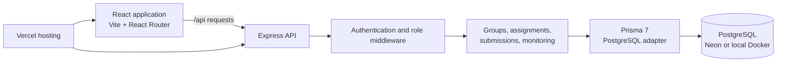

# Joineazy

A role-based group assignment management platform for students and professors. Students create groups, access assignments and individually confirm that their group has submitted its work through the professor-provided OneDrive link. Professors create and distribute assignments, then monitor group progress and each student's confirmation.

> Joineazy records submission confirmations; it does not upload, store, or inspect assignment files. File submission takes place externally through OneDrive.

## Features

### Student workspace

- Register with name, email, official student ID and password; sign in and sign out.
- Create one group and become its leader.
- Search for registered students by name, email or student ID and add available students as group members. Only the group leader can add members.
- View assignments available to all students or specifically assigned to the student's group.
- Open the professor's HTTPS OneDrive submission link.
- Confirm the group submission individually through a two-step confirmation flow.
- See group progress, each member's confirmation state and recorded timestamps.

### Professor workspace

- Sign in through the provisioned admin account.
- Create and edit assignments with a title, description, deadline and OneDrive link.
- Distribute an assignment to all students or selected groups.
- View workspace counts for students, students without a group, groups, assignments, completed group-assignment pairs and overdue pairs.
- Review progress for each eligible group and inspect individual student confirmations and timestamps.
- Filter monitoring by assignment and group-assignment status.
- Review the status breakdown and the overall completion metric.

## Technology stack

| Layer           | Technology                                                           |
| --------------- | -------------------------------------------------------------------- |
| Frontend        | React 19, TypeScript 5.9, Vite 7                                     |
| Routing         | React Router 7                                                       |
| Styling         | Tailwind CSS 4                                                       |
| Backend         | Node.js 22, Express 5, TypeScript 5.9 (ESM / NodeNext)               |
| API validation  | Zod 4                                                                |
| Database access | Prisma 7 with the PostgreSQL `pg` adapter                            |
| Database        | PostgreSQL (local Docker or Neon)                                    |
| Authentication  | JWT signed with `jose`, HttpOnly cookie, `bcryptjs` password hashing |
| Testing         | Vitest and Supertest                                                 |
| Quality tools   | ESLint 9 and Prettier 3                                              |
| Hosting target  | Single Vercel project with Neon PostgreSQL                           |

Exact dependency versions are pinned in the workspace `package.json` files and `package-lock.json`.

## Architecture overview

The repository is an npm-workspaces monorepo with separate `frontend/` and `backend/` applications. During local development, Vite proxies `/api` requests to Express. In the deployment layout, Vercel serves the built React application and routes `/api/*` requests to the Express application exposed by `api/index.ts`. The browser and API share one origin, allowing the session cookie to remain first-party.



For the detailed component boundaries, request lifecycle, security controls and deployment flow, see [System Design](docs/SYSTEM_DESIGN.md). For the relational model and its constraints, see [Database Design](docs/DATABASE_DESIGN.md).

## Repository structure

```text
.
├── api/
│   └── index.ts                 # Vercel Express function entry point
├── backend/
│   ├── prisma/
│   │   ├── schema.prisma        # Relational data model
│   │   └── seed.ts              # Idempotent professor account seed
│   ├── src/
│   │   ├── config/              # Validated environment configuration
│   │   ├── lib/                 # Prisma, password and session helpers
│   │   ├── middleware/          # Authentication, authorization and errors
│   │   ├── modules/             # Auth, groups, assignments, submissions, monitoring
│   │   ├── types/               # Shared Express request types
│   │   └── utils/               # Validation, normalization and application errors
│   └── tests/                   # Backend unit and API tests
├── docs/
│   ├── SYSTEM_DESIGN.md
│   └── DATABASE_DESIGN.md
├── frontend/
│   └── src/
│       ├── components/          # Shared layout and form components
│       ├── features/            # Auth, groups, assignments and dashboards
│       └── lib/                 # Typed API client
├── Dockerfile.backend
├── Dockerfile.frontend
├── docker-compose.yml
├── package.json                # npm workspace scripts
└── vercel.json                 # Single-origin Vercel routing/build settings
```

## Prerequisites

- Node.js 22.x and npm.
- Docker Desktop for the local PostgreSQL workflow, or a PostgreSQL-compatible Neon database.
- Git.

## Getting started

### 1. Install dependencies

Run from the repository root:

```powershell
npm install
```

The root `postinstall` script generates the Prisma client. The generated client is not committed to Git.

### 2. Configure environment variables

Copy `.env.example` to `.env` in the repository root and provide a strong `JWT_SECRET` (at least 32 characters). Configure the admin account values before running the seed command. Keep `.env` out of version control.

```powershell
Copy-Item .env.example .env
```

### 3. Start PostgreSQL and create the initial migration

The local Compose database publishes PostgreSQL on host port `5433` to avoid conflicting with a local service already using `5432`.

```powershell
npm run db:up
npm run db:migrate --workspace=backend -- --name init
```

The initial migration is generated from the current Prisma schema on the developer's machine. Commit the generated `backend/prisma/migrations/` directory so subsequent environments can use the migration history.

For a hosted database, set `DATABASE_URL` to the pooled connection string for application runtime and `DIRECT_URL` to the direct connection string for Prisma migrations and seeding. Use `npm run db:deploy` to apply committed migrations.

### 4. Seed the professor account

Set `ADMIN_NAME`, `ADMIN_EMAIL` and `ADMIN_PASSWORD` in `.env`, then run:

```powershell
npm run db:seed
```

The seed is idempotent. It creates the configured admin if missing and updates that account's name, password hash and role when it already exists. Do not commit demo passwords or production credentials.

### 5. Start the applications

Open two terminals from the repository root.

Terminal 1:

```powershell
npm run dev:backend
```

Terminal 2:

```powershell
npm run dev:frontend
```

Vite serves the frontend (normally at `http://localhost:5173`) and proxies `/api` to the Express development server (normally port `4000`). The browser should use the Vite origin; do not call the backend port directly for the normal cookie-based browser flow.

## Environment variables

| Variable               | Required    | Purpose                                                                                         |
| ---------------------- | ----------- | ----------------------------------------------------------------------------------------------- |
| `NODE_ENV`             | No          | `development`, `test` or `production`; defaults to `development`.                               |
| `PORT`                 | No          | Local Express port; defaults to `4000`.                                                         |
| `DATABASE_URL`         | Yes         | PostgreSQL connection used by the application at runtime.                                       |
| `DIRECT_URL`           | No          | Direct PostgreSQL connection for migration/seed operations; use with Neon.                      |
| `JWT_SECRET`           | Yes         | At least 32 characters; never use the example placeholder.                                      |
| `JWT_EXPIRES_IN_HOURS` | No          | Session lifetime in hours; defaults to `24`, maximum `168`.                                     |
| `AUTH_COOKIE_NAME`     | No          | Session cookie name; defaults to `joineazy_session`.                                            |
| `APP_ORIGIN`           | No          | Allowed local frontend origin for state-changing requests; defaults to `http://localhost:5173`. |
| `BCRYPT_ROUNDS`        | No          | Password hashing work factor; defaults to `12`.                                                 |
| `ADMIN_NAME`           | Seed only   | Name for the provisioned admin account.                                                         |
| `ADMIN_EMAIL`          | Seed only   | Email for the provisioned admin account.                                                        |
| `ADMIN_PASSWORD`       | Seed only   | Password for the provisioned admin account.                                                     |
| `POSTGRES_USER`        | Docker only | Local Compose database user.                                                                    |
| `POSTGRES_PASSWORD`    | Docker only | Local Compose database password.                                                                |
| `POSTGRES_DB`          | Docker only | Local Compose database name.                                                                    |

Variables prefixed with `VITE_` are exposed to the browser bundle. Do not put secrets in `VITE_` variables.

## API reference

All API routes are prefixed with `/api`. Successful responses use `{ "data": ... }`; errors use `{ "error": { "code", "message", "details" } }`.

| Method  | Endpoint                             | Access               | Purpose                                                                                                |
| ------- | ------------------------------------ | -------------------- | ------------------------------------------------------------------------------------------------------ |
| `GET`   | `/health`                            | Public               | Liveness check; does not query the database.                                                           |
| `GET`   | `/health/ready`                      | Public               | Readiness check; runs `SELECT 1`.                                                                      |
| `POST`  | `/auth/register`                     | Public               | Register a student and create a session.                                                               |
| `POST`  | `/auth/login`                        | Public               | Verify credentials and create a session.                                                               |
| `POST`  | `/auth/logout`                       | Public               | Clear the session cookie.                                                                              |
| `GET`   | `/auth/me`                           | Signed in            | Return the current user.                                                                               |
| `POST`  | `/groups`                            | Student              | Create a group; creator becomes leader and first member.                                               |
| `GET`   | `/groups/me`                         | Student              | Return the current student's group.                                                                    |
| `POST`  | `/groups/:groupId/members`           | Group leader         | Add a registered student by email or student ID.                                                       |
| `GET`   | `/students/search?q=`                | Student group leader | Search for students who are not already in a group.                                                    |
| `GET`   | `/assignments`                       | Student              | List assignments available to the student's group (or all-student assignments before joining a group). |
| `GET`   | `/assignments/:assignmentId`         | Eligible student     | Return an assignment available to the student's group.                                                 |
| `POST`  | `/submissions/:assignmentId/confirm` | Eligible student     | Record the authenticated student's confirmation; retries are idempotent.                               |
| `GET`   | `/admin/groups`                      | Admin                | List groups for assignment targeting.                                                                  |
| `GET`   | `/admin/assignments`                 | Admin                | List assignments.                                                                                      |
| `GET`   | `/admin/assignments/:assignmentId`   | Admin                | Retrieve an assignment for editing.                                                                    |
| `POST`  | `/admin/assignments`                 | Admin                | Create an assignment.                                                                                  |
| `PATCH` | `/admin/assignments/:assignmentId`   | Admin                | Edit assignment details and targeting.                                                                 |
| `GET`   | `/admin/overview`                    | Admin                | Return summary counts and all eligible group-assignment status metrics.                                |
| `GET`   | `/admin/monitoring`                  | Admin                | Return per-assignment/per-group progress, including member confirmation timestamps.                    |

`GET /admin/monitoring` accepts optional `assignmentId` (UUID) and `status` (`PENDING`, `IN_PROGRESS`, `OVERDUE`, `COMPLETED` or `COMPLETED_LATE`) query parameters.

## Submission states and completion metric

Each student confirms individually after their group has uploaded its work through OneDrive. The server records the authenticated student ID, the student's current group and a server-generated timestamp. The client cannot supply or override those fields. A repeated confirmation for the same assignment returns the existing record.

Group progress is derived from the current group membership and individual confirmations; percentages are not stored. Adding a member after earlier confirmations increases the denominator and can reduce the percentage.

| Status           | Meaning                                                                                   |
| ---------------- | ----------------------------------------------------------------------------------------- |
| `PENDING`        | No current group member has confirmed and the deadline has not passed.                    |
| `IN_PROGRESS`    | Some, but not all, current group members have confirmed before the deadline.              |
| `OVERDUE`        | The deadline has passed and at least one current member remains unconfirmed.              |
| `COMPLETED`      | Every current group member confirmed on or before the deadline.                           |
| `COMPLETED_LATE` | Every current group member confirmed, but the latest confirmation was after the deadline. |

The professor's overall completion percentage is **completed group-assignment pairs (on-time and late) divided by all eligible group-assignment pairs**, rounded to the nearest whole percentage. An eligible pair is a group and assignment combination permitted by the assignment's distribution rule. With no eligible pairs, the displayed percentage is zero.

## Development and quality commands

Run commands from the repository root unless otherwise stated.

```powershell
npm run typecheck
npm run lint
npm run format:check
npm test
npm run build
```

The root `build` script builds the frontend. The backend can also be compiled separately:

```powershell
npm run build --workspace=backend
```

Backend tests use Vitest and Supertest. Database access in route/service tests should be mocked unless a deliberate database-backed test environment has been configured. The end-to-end walkthrough below is a manual integration checklist; it is not a claim that a live database or deployment has already been verified.

## Manual end-to-end walkthrough

1. Seed and sign in as the professor; confirm the professor-only dashboard and assignment management are available.
2. Register two students using distinct official student IDs and verify they can sign in independently.
3. As the first student, create a group. Confirm that the creator is the leader and a member.
4. As the leader, search for the second student using their email or student ID and add them. Confirm the second student cannot create or join another group.
5. As the professor, create one assignment for all students and another for a selected group. Include valid HTTPS OneDrive links and distinct deadlines.
6. Confirm both students can see the all-student assignment, while only the selected group can see the targeted assignment.
7. Open the OneDrive link from a student assignment and complete the external upload using the test/demo link.
8. Confirm as the first student. Verify progress changes from `0%` to a partial value, and the second student remains pending.
9. Confirm as the second student. Verify progress reaches `100%`, the group becomes completed (or completed late, depending on the test deadline), and each student's timestamp is visible to the professor.
10. As the professor, inspect summary counts, filter by assignment and status, expand the group and verify both member records and the overall metric definition.
11. Verify a student receives `403` from admin-only endpoints and cannot retrieve assignments targeted to another group.
12. Repeat the key screens at approximately 360, 768, 1024 and 1440 CSS pixels; verify keyboard navigation, visible focus, dialog focus containment, accessible labels and readable progress text.

## Deployment

The intended deployment is one Vercel project with a Neon PostgreSQL database. The React build is served as static output and API requests are routed to the Express function through `api/index.ts`; this same-origin arrangement supports the HttpOnly session cookie without cross-origin cookie configuration.

1. Create a Neon PostgreSQL project on a free plan and select a region close to the Vercel function region.
2. Set the pooled Neon connection as `DATABASE_URL` and the direct connection as `DIRECT_URL` for migration and seed operations.
3. Apply the committed migrations with `npm run db:deploy` and provision the admin with `npm run db:seed`.
4. Import the repository into Vercel using the **Other** framework preset. Keep the repository's `vercel.json` build and output settings.
5. Configure production `DATABASE_URL` and `JWT_SECRET` in Vercel. Configure any other required environment values as applicable; never commit them.
6. Deploy and verify `/api/health` and `/api/health/ready`, then execute the complete manual walkthrough against the live URL.

The Vercel Hobby plan has personal/non-commercial use restrictions. Recheck the current Vercel and Neon terms and quotas before deployment. This assignment demo must remain on free tiers; do not start a paid trial, upgrade, purchase a domain or enable a paid add-on. If the free-plan terms or quotas do not fit, stop and reassess before proceeding. Neon can scale compute to zero while idle, so the first request after inactivity may take longer than subsequent requests.

## Demo accounts

Student accounts are self-registered using the registration page. The professor account is provisioned from `ADMIN_NAME`, `ADMIN_EMAIL` and `ADMIN_PASSWORD` through the seed command. Credentials are environment-specific and are intentionally not stored in this repository. Create dedicated demo accounts before recording the walkthrough, and share credentials only through the intended private evaluation channel.

## Known limitations and product boundaries

- Student IDs are collected from the student and normalized; they are not verified against an external institution registry.
- Students can belong to one group. Group leaders can add eligible members; group dissolution, member removal and transfers are not included.
- Assignments can be created and edited but not deleted. Assignment targeting cannot be changed after a confirmation exists.
- Submission files remain in OneDrive; Joineazy stores confirmation metadata only.
- Authentication endpoints do not currently use a distributed rate limiter. Do not add an in-memory limiter on a serverless deployment and assume it provides global protection.
- Admin analytics are operational counts and derived group-assignment statuses, not advanced reporting or performance scoring.
- Free hosting plans can change their quotas and terms. Verify them at deployment time.
